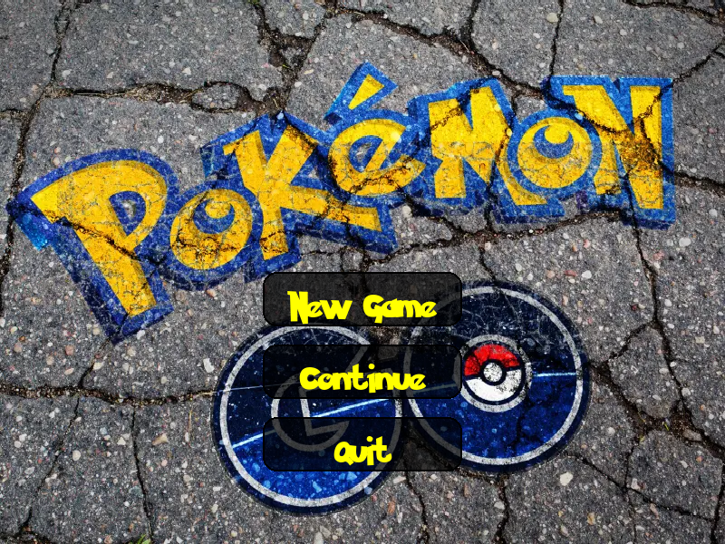
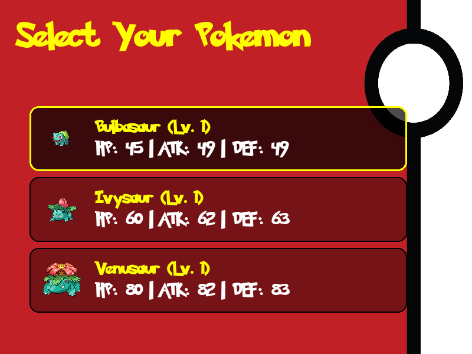
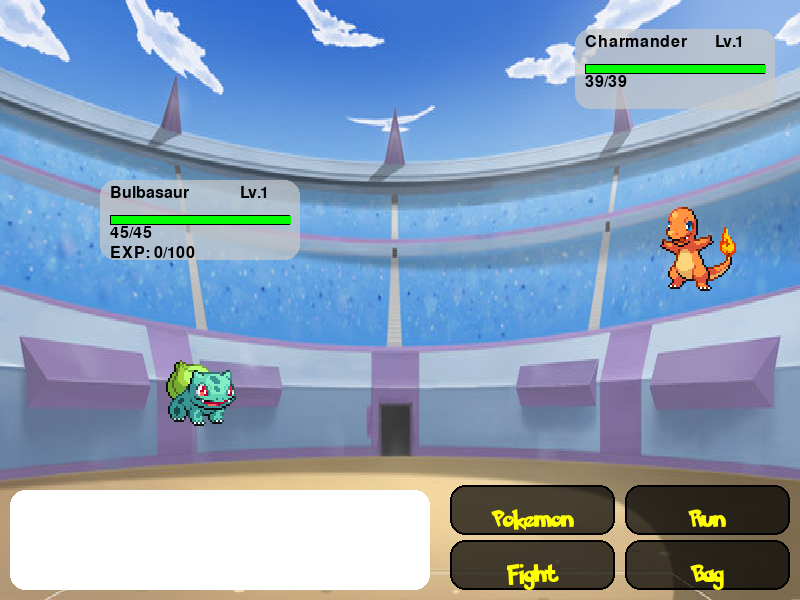
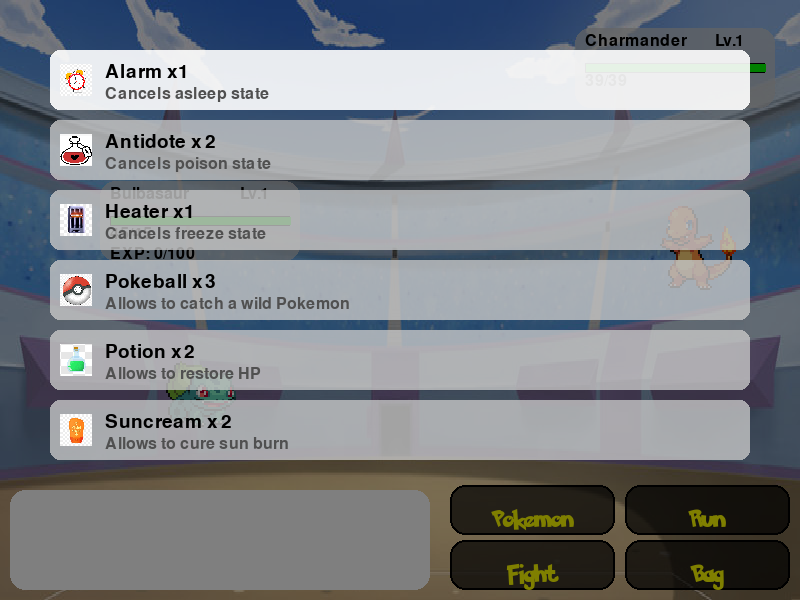

# 🎮 Pokémon Battle Game / Jeu de Combat Pokémon

[](https://www.python.org/)
[](https://www.pygame.org/)
[](LICENSE)

*Read this in [English](#english) | Lire en [Français](#français)*

---

<a name="english"></a>
## 🇬🇧 English

A 2D turn-based Pokémon battle game built in Python using **Pygame** and integrated with **PokeAPI** for Pokémon stats and sprites. Features animated battles, sound effects, custom fonts, bag item usage, Pokémon evolution, and persistent Pokédex save files.

### 📸 Screenshots

| Main Menu | Starter Selection |
| :---: | :---: |
|  |  |
| **Battle Arena** | **Bag & Inventory** |
|  |  |

---

### ✨ Features

- **Dynamic Battle Arenas**: Arena backgrounds automatically match the enemy Pokémon's elemental type (cave, grass, water, gym).
- **Animated Combat**: Floating Pokémon sprites, hit shake/flash feedback, and animated elemental attack GIFs (Fire, Water, Electric, Normal).
- **Sound Effects & Music**: Dedicated background themes for menus and battles, button hover/click feedback, and attack sounds.
- **Bag & Items System**:
  - **Potion**: Restores Pokémon HP.
  - **Pokeball**: Attempt to capture wild Pokémon.
  - **Status Curatives**: Antidote (poison), Heater (freeze), Alarm (sleep), Suncream (burn).
- **Progression & Evolution**: Gain experience after victories, level up stats, and evolve when reaching evolution thresholds.
- **Persistent Save System**: Trainer progress and Pokémon teams are automatically saved to and loaded from JSON files.

---

### 🚀 Getting Started

#### Prerequisites
- **Python 3.9+**
- **pip** package manager

#### 1. Clone the Repository
```bash
git clone https://github.com/sergey-chukhno/pokemon.git
cd pokemon
```

#### 2. Create and Activate a Virtual Environment
```bash
# macOS / Linux
python3 -m venv .venv
source .venv/bin/activate

# Windows (Command Prompt)
python -m venv .venv
.venv\Scripts\activate
```

#### 3. Install Dependencies
```bash
pip install --upgrade pip
pip install -r requirements.txt
```

#### 4. Launch the Game
```bash
python3 main.py
```

---

### 🕹️ How to Play

1. **Main Menu**:
   - Click **New Game** to start a new adventure.
   - Click **Continue** to load an existing trainer profile.
   - Click **Quit** to exit.
2. **Trainer Name**: Type your name and press <kbd>Enter</kbd>.
3. **Select Pokémon**:
   - Use <kbd>↑</kbd> / <kbd>↓</kbd> arrows or mouse click to browse Pokémon.
   - Press <kbd>Enter</kbd> or click to choose up to 3 Pokémon for your team.
4. **In Battle**:
   - **Fight**: Click any of your Pokémon's attack moves to strike.
   - **Bag**: Click **Bag** to use healing potions, status remedies, or Pokeballs.
   - **Switch**: Swap to another healthy Pokémon from your party.
   - **Run**: Attempt to escape the battle.
   - **Audio Toggle**: Click the speaker icon in the top corner to mute/unmute audio.
5. **Evolution & Saving**:
   - Winning battles grants experience points. When reaching the required level, your Pokémon will undergo an animated evolution.
   - Your team's HP, levels, and roster are saved automatically upon battle completion.

---

<a name="français"></a>
## 🇫🇷 Français

Un jeu de combat Pokémon 2D au tour par tour développé en Python avec **Pygame** et connecté à **PokeAPI** pour les données et sprites des Pokémon. Comprend des animations de combat, des effets sonores immersifs, un inventaire d'objets, l'évolution des Pokémon et la sauvegarde automatique de la progression.

### ✨ Fonctionnalités Principales

- **Arènes Dynamiques** : Les décors d'arène s'adaptent automatiquement au type du Pokémon adverse (grotte, herbe, eau, arène).
- **Animations de Combat** : Sprites animés, secousses et flash lors des coups reçus, et effets d'attaques animés (Feu, Eau, Électrique, Normal).
- **Effets Sonores et Musique** : Musiques thématiques pour le menu et les combats, bruitages de survol et de clic, sons d'attaques dédiés.
- **Inventaire et Objets** :
  - **Potion** : Restaure les PV du Pokémon.
  - **Pokéball** : Permet de capturer un Pokémon sauvage.
  - **Soins d'états** : Antidote (poison), Chaufferette (gel), Réveil (sommeil), Crème solaire (brûlure).
- **Évolution et Niveaux** : Gagnez de l'expérience après chaque victoire, augmentez vos statistiques et faites évoluer vos Pokémon.
- **Sauvegarde Automatique** : Les données de votre équipe sont enregistrées dans un fichier JSON pour pouvoir reprendre votre partie à tout moment.

---

### 🚀 Installation et Lancement

#### Prérequis
- **Python 3.9+**
- Gestionnaire de paquets **pip**

#### 1. Cloner le Dépôt
```bash
git clone https://github.com/sergey-chukhno/pokemon.git
cd pokemon
```

#### 2. Créer et Activer un Environnement Virtuel
```bash
# macOS / Linux
python3 -m venv .venv
source .venv/bin/activate

# Windows (Invite de commandes)
python -m venv .venv
.venv\Scripts\activate
```

#### 3. Installer les Dépendances
```bash
pip install --upgrade pip
pip install -r requirements.txt
```

#### 4. Lancer le Jeu
```bash
python3 main.py
```

---

### 🕹️ Guide de Jeu

1. **Menu Principal** :
   - Cliquez sur **New Game** pour créer une nouvelle partie.
   - Cliquez sur **Continue** pour charger une partie existante.
   - Cliquez sur **Quit** pour quitter le jeu.
2. **Nom du Dresseur** : Entrez votre pseudonyme et appuyez sur <kbd>Entrée</kbd>.
3. **Sélection de l'Équipe** :
   - Utilisez les flèches <kbd>↑</kbd> / <kbd>↓</kbd> ou la souris pour faire défiler la liste.
   - Cliquez ou appuyez sur <kbd>Entrée</kbd> pour sélectionner jusqu'à 3 Pokémon de départ.
4. **Déroulement du Combat** :
   - **Attaquer** : Choisissez une attaque parmi les capacités disponibles.
   - **Sac (Bag)** : Utilisez une potion, un remède d'état ou une Pokéball pour capturer le Pokémon sauvage.
   - **Changer de Pokémon** : Remplacez votre combattant actuel par un autre membre valide de votre équipe.
   - **Fuite (Run)** : Tentez de fuir le combat.
   - **Contrôle Audio** : Cliquez sur l'icône de haut-parleur en haut pour activer ou couper le son.
5. **Évolution et Sauvegarde** :
   - Chaque combat victorieux octroie des points d'expérience. Une fois le niveau requis atteint, une animation d'évolution se déclenche.
   - Votre Pokédex et l'état de votre équipe sont sauvegardés automatiquement après chaque affrontement.

---

### 📁 Structure du Projet / Project Structure

```text
pokemon/
├── assets/
│   ├── fonts/              # Custom fonts (pokemonsolid.ttf)
│   ├── images/
│   │   ├── battle/         # Battle backgrounds, bag items, attack GIFs, states
│   │   └── menu/           # Menu wallpapers, pokeball backgrounds
│   ├── screenshots/        # Game screenshots for documentation
│   └── sounds/             # Background music, click, hover, attack SFX
├── data/
│   ├── pokedex/            # Player personal pokedex save files
│   ├── sprites/            # 30 Pokémon front sprites
│   ├── api_handler.py      # PokeAPI integration helper
│   ├── data_loader.py      # Pokemons and player data loader/saver
│   └── pokemons.json       # Local database of Pokémon stats & moves
├── models/
│   ├── battle.py           # BattleSystem logic, animations, attack handlers
│   ├── evolution.py        # Evolution animation and stat adjustments
│   ├── game.py             # Main game state loop and music orchestration
│   ├── menu.py             # Main menu, starter selection, UI buttons
│   └── pokemon.py          # Pokemon class (stats, HP, leveling)
├── config.py               # Game configurations, paths, window settings
├── main.py                 # Application entry point
├── requirements.txt        # Python package dependencies
└── README.md               # Project documentation (EN/FR)
```
